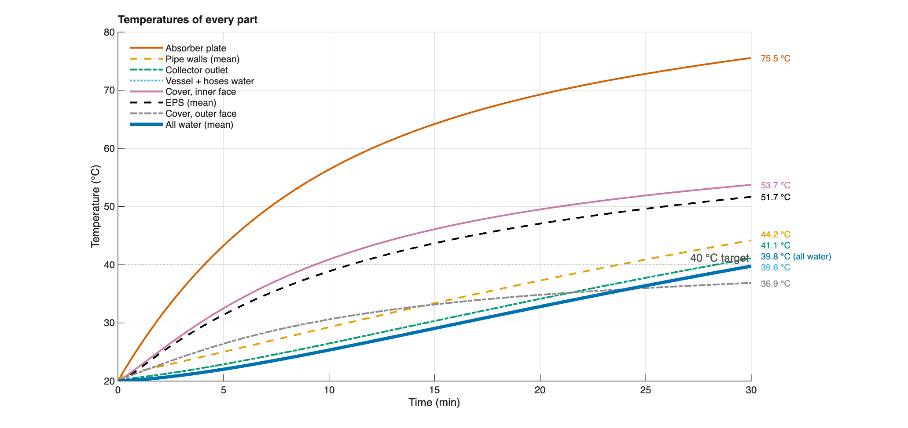
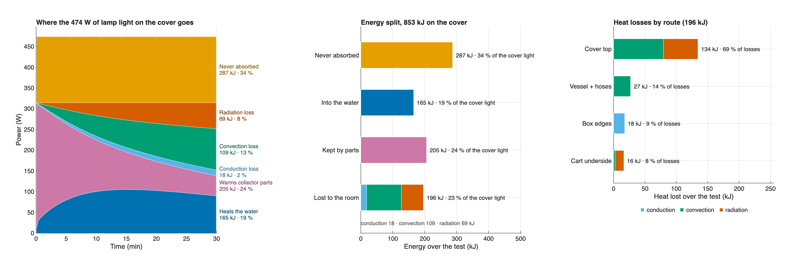
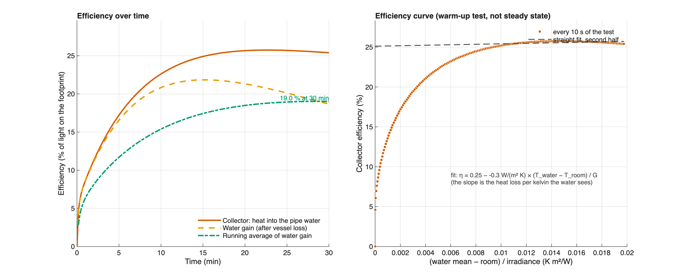
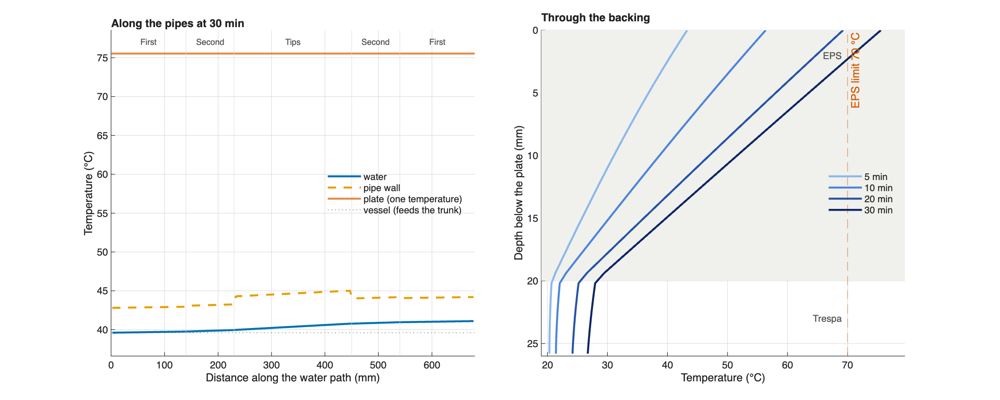
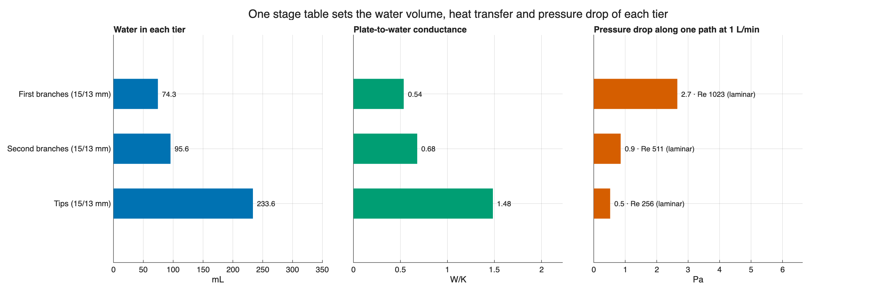
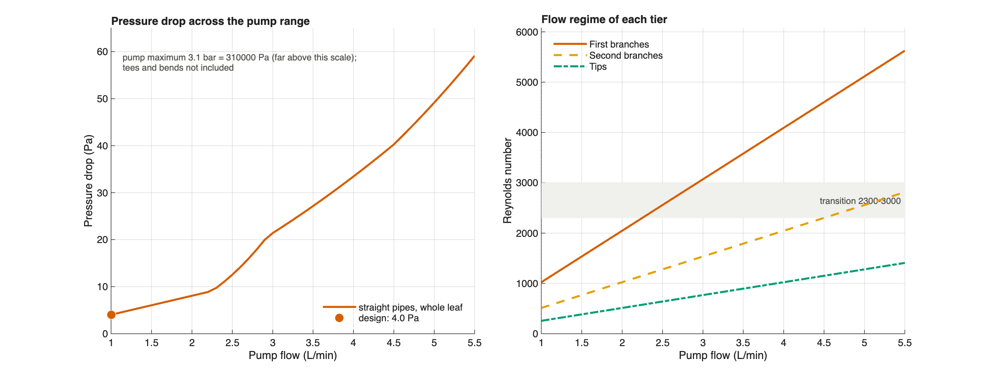

# Leaf model results

Model `simulink/solar_collector.slx` (Simulink ode15s (solar_collector.slx)), inputs `collector_inputs.m`, run 2026-10-15 18:53. Test: 1000 W/m², 1 L/min, 30 min, room 20 °C.

## Key numbers

| Quantity | Result |
|---|---:|
| All water (energy-weighted mean) after 30 min | 39.75 °C |
| Time to 40 °C: all water / vessel water | not reached / not reached |
| Heat into the water | 165 kJ |
| Efficiency: water heat / light on the footprint | 19.0 % |
| Plate above the water at the end | 35.8 K |
| Collector outlet / absorber plate at the end | 41.10 / 75.55 °C |
| Light absorbed / lost / stored | 566.3 / 195.7 / 370.6 kJ |
| Straight-pipe pressure drop along one path (tees, bends excluded) | 4.0 Pa |
| Tube water in the collector / tube length | 403.5 mL / 3.040 m |
| Diffuse opening view factor / rim optical access | 0.91867 / 0.93494 |
| External vessel and hose heat-loss conductance | 1.65847 W/K |

## Checks of the calculation (all passed before these files were written)

- Solver: 10x tighter tolerance changes temperatures by at most 1.7e-06 K.
- Grid: doubling water cells and backing layers changes temperatures by at most 0.0047 K.
- Energy: absorbed - lost - stored = -9.9e-09 J.

## Guardrails: usable with care; read the WARN lines

Is the result inside what the model assumes? FAIL: do not use; WARN: an assumption is broken, error either way; NOTE: broken, but the model errs on the safe side.

| Level | Check | Value | Limit | Meaning |
|---|---|---|---|---|
| WARN | EPS below its service limit | 75.5 C | < 70 C | the EPS touches the plate; above its limit it softens and shrinks |
| NOTE | First branches: developed velocity profile (Hausen) | entrance 665 mm | < pipe 140 mm | Hausen assumes a developed velocity profile; a developing one gives a thinner film: more heat reaches the water |
| NOTE | Second branches: developed velocity profile (Hausen) | entrance 332 mm | < pipe 90 mm | Hausen assumes a developed velocity profile; a developing one gives a thinner film: more heat reaches the water |
| OK | Energy conserved | -9.9e-09 J | < 1e-06 x absorbed | every joule absorbed is either stored or lost |
| OK | Solver tolerance converged | 1.7e-06 K | < 0.01 K | 10x tighter solver tolerance barely moves any temperature |
| OK | Grid converged | 0.0047 K | < 0.01 K | doubling the water cells and backing layers barely moves any temperature |
| OK | Water stays liquid | 20.0 to 41.1 C | 0 to 100 C | the model has no ice or steam |
| OK | Water properties fixed at 30 C | 20.0 to 41.1 C | 15 to 60 C | outside this range the fixed viscosity and conductivity drift |
| OK | Pipe below its service limit | 46.0 C | < 60 C | hottest pipe outer surface; check the tube datasheet |
| OK | Flow inside the pump range | 1 L/min | 1 to 5.5 L/min | the course pump cannot run outside this range |
| OK | Pressure drop small for the pump | 4.0 Pa | < 31000 Pa | straight pipes only; tees and bends add more |
| OK | Footprint within the course limit | 720 x 670 mm | 720 x 670 mm | a larger collector breaks the brief |
| OK | First branches: clear flow regime | Re 1023 | not 2300-3000 | between laminar and turbulent the film coefficient is a straight-line guess |
| OK | Second branches: clear flow regime | Re 511 | not 2300-3000 | between laminar and turbulent the film coefficient is a straight-line guess |
| OK | Tips: clear flow regime | Re 256 | not 2300-3000 | between laminar and turbulent the film coefficient is a straight-line guess |
| OK | Tips: developed velocity profile (Hausen) | entrance 166 mm | < pipe 220 mm | Hausen assumes a developed velocity profile; a developing one gives a thinner film: more heat reaches the water |
| OK | Gap convection correlation in range | Ra 33353 | < 1e+05 | Hollands correlation fitted up to here |
| OK | Gap air near its assumed temperature | 64.6 C | 47 +/- 20 C | air properties in the gap are fixed at air_film_temperature_k |
| OK | Underside radiation stays near linear | 6.7 K above room | < 20 K | the underside uses a fixed radiation coefficient |

## Figures

## Assumptions

- Equal flow in every branch of the symmetric leaf; one absorber temperature.
- Vessel and hoses are one mixed water temperature.
- Diffuse solar screening uses the finite opening geometry; direct light is assumed normal to the opening. Longwave plate-to-cover exchange separately uses a view factor of one.
- External-loop conductance follows the entered vessel and hose geometry unless heat.loop_ua supplies an explicit value.
- Black paint, LDPE conductivity, a bare tube resting on the plate (line contact through an air gap) and fixed material properties are assumed (see collector_inputs.m).
- Flow is imposed (1 L/min), not solved from the pump curve.
- The outlet is the last collector water cell; sensor-line transport is not modelled.
- Each water cell has its own tube-wall cell (half the wall resistance on each side).
- The back loses heat through layered EPS and the Trespa plate, both storing heat; edges are one steady conductance.
